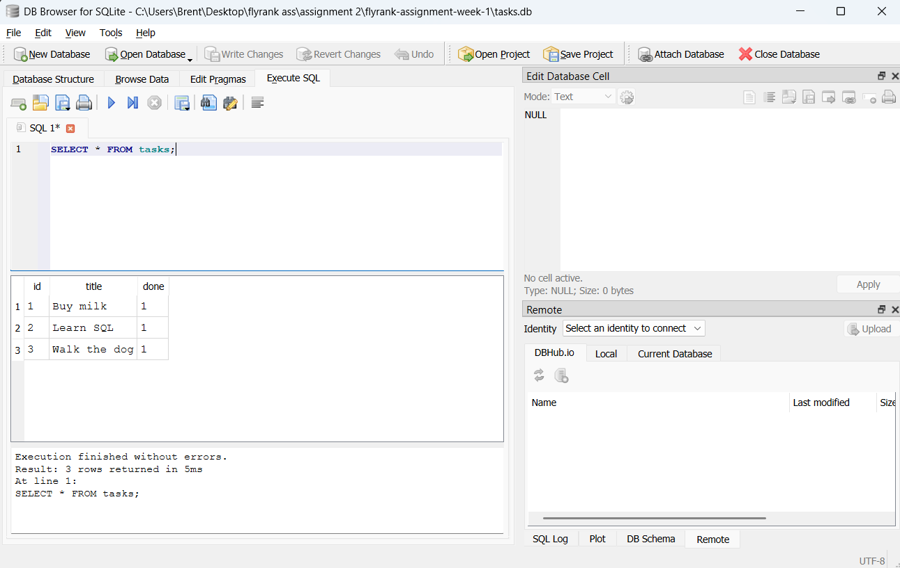

# Tasks API with SQLite

A small CRUD API for tasks, built with Python and [FastAPI](https://fastapi.tiangolo.com/). Tasks are stored in a SQLite database, so they're still there after the server restarts.

```
Client -> API (main.py) -> SQLite (tasks.db)
```

## Why SQLite

- **Nothing to install or run.** SQLite ships with Python (`sqlite3`), and the whole database is a single file.
- **It's real SQL.** The queries here (`SELECT`, `INSERT`, `UPDATE`, `DELETE`) work the same way in PostgreSQL or MySQL.
- **It's enough for this project.** One server, one file, small data. A separate database server would only add setup.

## Where the database lives

The database is `tasks.db`, in the project root next to `main.py`. It's created automatically the first time the app starts:

1. If the `tasks` table doesn't exist, the app creates it: `id INTEGER PRIMARY KEY, title TEXT, done BOOLEAN`.
2. If the table is empty, the app inserts three example tasks. Restarts don't add duplicates.

`tasks.db` is listed in `.gitignore`, so every clone starts with a fresh database.

## How to start

Requires Python 3.10+.

```bash
python -m venv .venv
.venv\Scripts\activate          # Windows
# source .venv/bin/activate     # macOS / Linux
pip install -r requirements.txt
uvicorn main:app --reload
```

The API runs at http://localhost:8000. Interactive docs are at http://localhost:8000/docs.

## Endpoints

| Method | Path          | Body                                | Success | Errors                       |
|--------|---------------|-------------------------------------|---------|------------------------------|
| GET    | `/tasks`      | none                                | 200     |                              |
| GET    | `/tasks/{id}` | none                                | 200     | 404 `{"error": "Task not found"}` |
| POST   | `/tasks`      | `{"title": "Buy milk", "done": false}` | 201  | 400 if `title` is missing or empty |
| PUT    | `/tasks/{id}` | `{"title": "...", "done": true}` (either field) | 200 | 400 invalid body, 404 unknown id |
| DELETE | `/tasks/{id}` | none                                | 204     | 404 unknown id               |

## Exploring the database

I opened `tasks.db` in [DB Browser for SQLite](https://sqlitebrowser.org/) and ran the queries in [`queries.sql`](queries.sql). Changes made in the viewer show up in `GET /tasks` right away, because the API reads from the same file.



Example query, listing only completed tasks:

```sql
SELECT * FROM tasks WHERE done = 1;
```

## Other files

`server.js` and `package.json` are the original Week 1 Express warm-up. The Tasks API doesn't use them.
